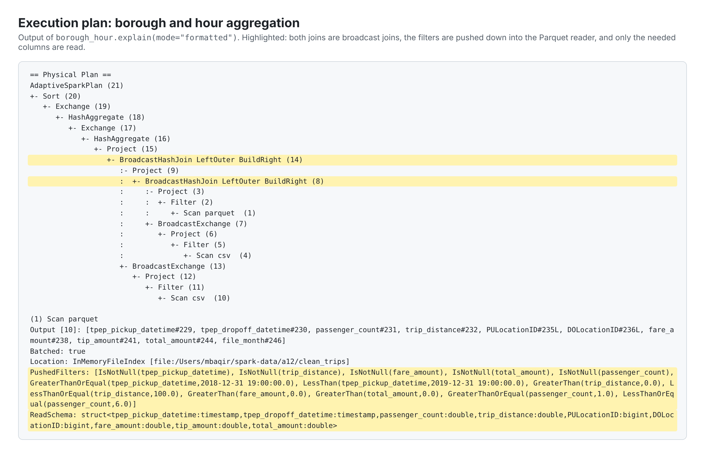
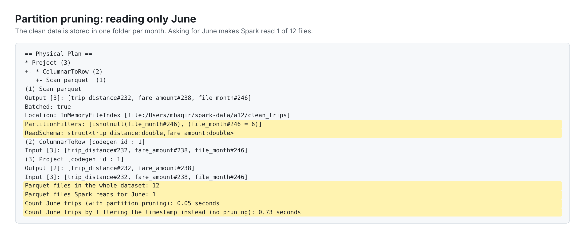
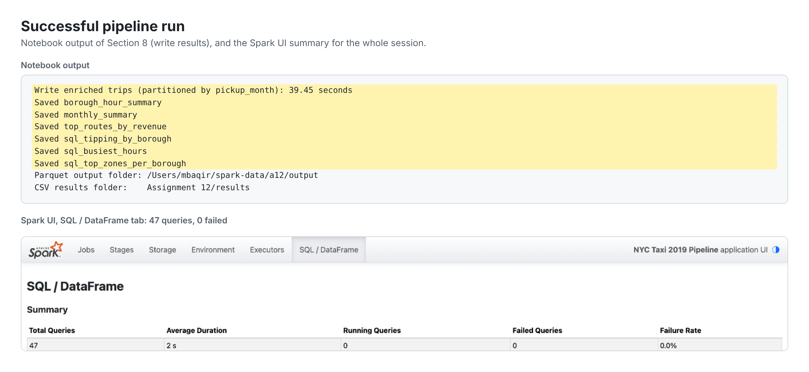
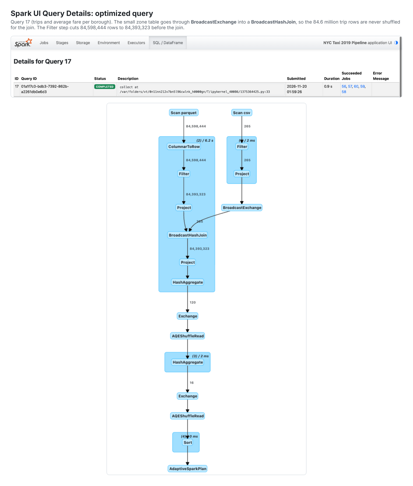

# NYC Yellow Taxi 2019: PySpark Data Processing Pipeline


A PySpark pipeline that loads one full year of New York City yellow taxi trips, cleans and enriches them, joins them with taxi zone names, answers questions with DataFrame code and Spark SQL, and writes the results to Parquet. The notebook also documents how Spark optimizes the work (execution plans, filter pushdown, partition pruning, broadcast joins and caching) and demonstrates lazy evaluation.

## Dataset

| | Trips | Zone lookup |
|---|---|---|
| Source | [NYC Taxi and Limousine Commission (TLC) Trip Record Data](https://www.nyc.gov/site/tlc/about/tlc-trip-record-data.page) | Same page, "Taxi Zone Lookup Table" |
| Files | 12 monthly Parquet files, `yellow_tripdata_2019-01.parquet` to `yellow_tripdata_2019-12.parquet` | `taxi_zone_lookup.csv` |
| Size | about 1.2 GB on disk | about 12 KB, about 265 rows |
| One row is | one yellow taxi trip | one taxi zone |

**Main trip columns:** pickup and drop-off date and time, passenger count, trip distance in miles, pickup and drop-off zone ID (`PULocationID`, `DOLocationID`), payment type, fare, tip, tolls, surcharges and total amount.

**Zone lookup columns:** `LocationID`, `Borough`, `Zone` and `service_zone`. Joining on the zone ID turns zone numbers into borough and neighborhood names.

**Why 2019:** it is a full, normal year before COVID-19, which changed taxi demand sharply in 2020.

The data is not stored in this repository because the files are far larger than GitHub allows. The download steps are below.

## Repository structure

```text
.
├── nyc_taxi_pyspark_pipeline.ipynb   # The full pipeline
├── nyc_taxi_pyspark_pipeline.html    # HTML export of the executed notebook
├── download_data.sh                  # Downloads the 12 monthly files and the zone table
├── requirements.txt                  # Python packages
├── results/                          # Small summary tables written by the pipeline (CSV)
└── screenshots/                      # Execution plan, successful run and Spark UI screenshots
```

## How to run

Requirements: Java 17 or 21, and Python 3.10 or newer.

1. Create and activate an environment, then install the packages:

   ```bash
   conda create -n spark-a12 python=3.12 -y
   conda activate spark-a12
   pip install -r requirements.txt
   ```

2. Download the data (about 1.2 GB) into `~/spark-data/a12`:

   ```bash
   bash download_data.sh
   ```

3. Open `nyc_taxi_pyspark_pipeline.ipynb` in VS Code or Jupyter, select the `spark-a12` kernel and run all cells. While it runs, the Spark UI is available at http://localhost:4040.

4. Export the executed notebook to HTML:

   ```bash
   jupyter nbconvert --to html nyc_taxi_pyspark_pipeline.ipynb
   ```

## Pipeline

1. **Load and standardize.** A schema check first confirms that all 12 monthly files store every column with the same type. As a safeguard, each month is still read separately and every column is cast to one agreed type, and all months are written once as a single Parquet dataset partitioned by `file_month`.
2. **Transform.**
   * Column pruning: only the 15 needed columns are selected.
   * Filters, applied first: pickups inside 2019, distance above 0 and at most 100 miles, positive fare and total, 1 to 6 passengers, then 1 to 180 minutes and at most 80 mph.
   * `withColumn` features: trip minutes, average speed, tip percent, pickup hour, month, weekday, weekend flag and payment method name.
   * Broadcast join with the zone lookup table, once for pickup and once for drop-off.
   * `groupBy` aggregations by borough and hour, by month, and by route (top 10 routes by revenue with at least 5,000 trips).
3. **SQL.** Three Spark SQL queries on a temporary view.  
Tipping by borough on weekdays vs weekends, the busiest hours of the day, and the top 3 pickup zones per borough using a `RANK()` window function.
4. **Optimize and measure.** `.explain(mode="formatted")` plans, a partition pruning test, a slow vs fast version comparison of the same query, and a caching test.
5. **Actions vs transformations.** Timing and Spark job counts before and after an action.
6. **Write.** The enriched trip table is written as Parquet partitioned by `pickup_month`. Summary tables are written as Parquet and as CSV in `results/`.
7. **Optional MLlib.** Linear regression predicting the fare from distance, minutes, hour, passengers and a weekend flag.

## Optimization strategies used

| Strategy | Where in the notebook |
|---|---|
| Filter early | Section 3, all quality filters run before the join and the aggregations |
| Column pruning | Section 3, `select` of 15 columns before any other step |
| Filter pushdown into the Parquet reader | Section 5.1, `PushedFilters` in the plan |
| Partitioning of the stored data | Section 2.2 (`file_month`) and Section 8 (`pickup_month`) |
| Partition pruning | Section 5.2, `PartitionFilters` in the plan and fewer files read |
| Broadcast join to avoid shuffling the large table | Sections 3.1 and 5.3 |
| Fewer shuffle partitions for a single machine (16 instead of 200) | Sections 1 and 5.3 |
| Adaptive Query Execution | Section 1 |
| Caching for repeated actions | Section 6 |

## Screenshots

**1. Execution plan (`.explain()`):** both zone joins are broadcast joins, 13 filter conditions are pushed into the Parquet reader, and only 9 columns are read.



**2. Partition pruning:** asking for June makes Spark read 1 of the 12 Parquet files.



**3. Successful pipeline execution:** the results were written, and the Spark UI shows 47 queries with 0 failures.



**4. Spark UI Query Details:** the optimized query, with the small zone table broadcast into a `BroadcastHashJoin`.



## Performance analysis

**How Spark optimized the query.** 
Spark's Catalyst optimizer rewrote the pipeline before running it. The plan in Screenshot 1 shows three things. 
First, column pruning: the `ReadSchema` lists only the 9 columns the pipeline uses, so the other columns in the Parquet files are never read from disk. 
Second, both joins with the zone table became `BroadcastHashJoin`s, the 265-row zone table is copied to every worker, so the 84 million trip rows never have to be shuffled for the join. 
Third, each `groupBy` runs as two `HashAggregate` steps, a partial sum inside each partition and a final one after the shuffle. In the Query Details view (Screenshot 4), this means only 120 partial rows crossed the shuffle instead of 84.4 million trip rows.

**Where filters were pushed down.** 
All of the early quality filters (pickup inside 2019, distance above 0 and at most 100 miles, positive fare and total, 1 to 6 passengers) appear in the `PushedFilters` list of the Parquet scan. The Parquet reader checks them using the minimum and maximum values stored for each block of rows, so it can skip blocks that cannot match. The filters that need new columns (trip minutes, speed) cannot be pushed into the file reader, but Spark still placed them in the same `Filter` step, before the joins. Partitioning the stored data by month added a second kind of skipping: with a filter on `file_month = 6`, the plan shows `PartitionFilters` and Spark read only 1 of 12 files, so counting June trips took 0.05 seconds instead of 0.73 seconds.

**Bottlenecks and how they were fixed.** 
The first full run failed while writing the results, because Spark ran out of memory: with 4 GB, the Parquet reader's "vectored" reads held too many large buffers at once. 
Raising the memory to 6 GB and turning vectored reads off fixed it. To measure the join and shuffle choices, the same borough summary was run twice. With a shuffle (sort merge) join and Spark's default 200 shuffle partitions it took 5.06 seconds, and with a broadcast join and 16 shuffle partitions it took 0.86 seconds, **5.9x faster**. 

Caching a narrow first-quarter table made three repeated actions **4.4x faster** (3.01 seconds without the cache, 0.69 seconds with it).

Finally, the lazy evaluation demo shows that building a chain of transformations took 0.03 seconds and started 0 Spark jobs, while the `count()` action took 0.15 seconds and started 2 jobs.

## Key findings

* **Data quality:** 84,598,444 trips were loaded and 81,228,290 (96.0%) were kept after removing trips outside 2019, zero or extreme distances, non-positive fares and impossible speeds.
* **Manhattan dominates:** about 91% of trips with a positive fare start in Manhattan (76.5 million). The average fare there is $11.53,  compared with  $36.40 in Queens, where most pickups are at JFK and LaGuardia airports.
* **Rush hour is the busiest and slowest:** 6 PM has the most pickups (5.35 million). Average speed falls to about 9.5 mph in the mid-afternoon, compared with 19.7 mph at 5 AM.
* **Seasonality:** March was the busiest month (7.58 million trips, $144 million in revenue) and August the quietest (5.81 million trips).
* **Airport routes earn the most:** the top route by revenue is JFK Airport to Times Square ($6.74 million, $68.67 per trip on average), followed by LaGuardia Airport to Times Square.
* **Tipping:** among credit card trips (the only payment type where tips are recorded), Manhattan riders tip about 25.8% of the fare on both weekdays and weekends, while Queens riders tip 30.1% on weekends compared with 23.5% on weekdays.
* **Fare model (MLlib):** a linear regression on a 1% sample explains 93.1% of the variation in fares (test R squared 0.931). For each 1 mile increase in trip distance, the expected fare increases by $2.10, and for each 1 minute increase in trip time, the expected fare increases by $0.29, holding the other features constant.
